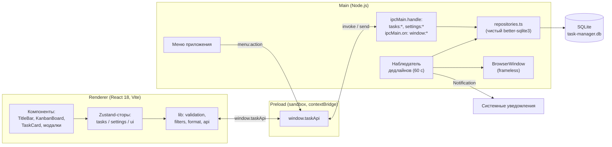
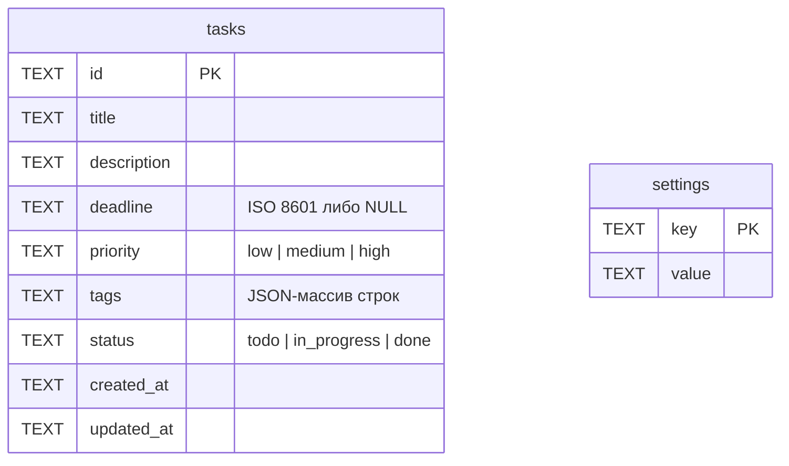
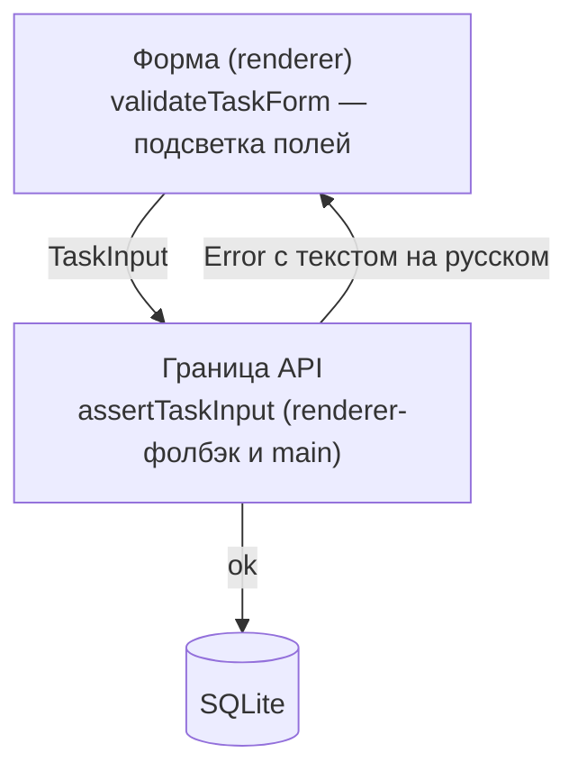
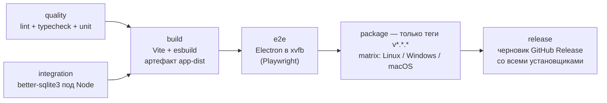

# Context — архитектура Task Manager

## Общая картина

Приложение построено по процессной модели Electron: **main** (Node.js) владеет
окном, меню и SQLite; **renderer** (React) не имеет доступа к Node и общается
с main только через **preload-мост** (`contextBridge` + `ipcRenderer.invoke`).
Благодаря единому контракту `TaskApi` renderer одинаково работает и с IPC-мостом,
и с localStorage-фолбэком для чисто браузерной разработки.

## Схема базы данных (SQLite)

Индексы: `idx_tasks_status(status)`, `idx_tasks_deadline(deadline)`.
Ключи настроек: `theme`, `notificationsEnabled`, `deadlineThresholdHours`, `onboarded`.

## Ключевые потоки

- **Создание/редактирование задачи.** Форма валидируется на клиенте
  (`validateTaskForm`), затем данные уходят в main, где происходит строгая
  проверка (`assertTaskInput`) перед записью в SQLite. Ошибка main-процесса
  показывается в форме как общая ошибка — обе ветки блок-схемы user flow
  («валидация пройдена / не пройдена») реализованы.
- **Смена статуса.** Drag & drop (@dnd-kit) или кнопки в деталях задачи →
  оптимистичное обновление стора → `tasks:update` по IPC; при ошибке откат.
- **Уведомления.** main каждую минуту перечитывает настройки и незакрытые
  задачи с дедлайном; уведомление показывается один раз на задачу, память
  сбрасывается при изменении задачи (`forget`).
- **Тема.** `data-theme` на `<html>`; режим `system` слушает `prefers-color-scheme`.
- **Онбординг.** Показывается, пока в настройках `onboarded = false`
  (первый запуск), завершение фиксируется в SQLite.

## Схема валидации (общая для слоёв)

## Места, которые важно знать при доработках

- Контракт IPC-каналов: `electron/preload.ts` ↔ `electron/ipc/*.ts` — менять
  синхронно.
- Список каналов: `tasks:list|create|update|delete`, `settings:get-all|set`,
  `window:minimize|toggle-maximize|close`, события: `window:state`, `menu:action`.
- Чистые модули (без electron/DOM): `electron/ipc/repositories.ts`,
  `src/lib/validation.ts`, `src/lib/filters.ts` — расширение логики лучше
  начинать здесь, оно автоматически попадёт под тесты.

## CI/CD (`.github/workflows/build.yml`)

Ключевые решения пайплайна:

- **Два ABI нативного модуля.** better-sqlite3 пересобирается под нужный
  рантайм: `npm rebuild better-sqlite3` (Node, integration) или
  `npx electron-builder install-app-deps` (Electron, e2e/упаковка). Там,
  где Electron не запускается (quality/build), установка идёт с
  `--ignore-scripts` — без скачивания бинарника (~100 МБ) и лишних сборок.
- **Headless-e2e.** При `CI=true` main-процесс вызывает
  `app.disableHardwareAcceleration()`, спека добавляет флаги
  `--no-sandbox --disable-gpu --disable-dev-shm-usage`; рендеринг —
  в виртуальном дисплее xvfb (1280x1024). Локальный запуск не меняется.
- **Воспроизводимость и скорость.** `package-lock.json` закоммичен;
  node_modules / Electron / electron-builder кэшируются по его хэшу;
  concurrency-группа отменяет устаревшие прогоны; у каждого job — таймаут.
- **Упаковка только по тегам.** `git tag v1.1.0 && git push --tags`
  запускает матрицу: Linux → AppImage, Windows → NSIS .exe, macOS → .dmg
  (без подписи: `CSC_IDENTITY_AUTO_DISCOVERY=false`); job release собирает
  черновик GitHub Release — публикация вручную после проверки.
